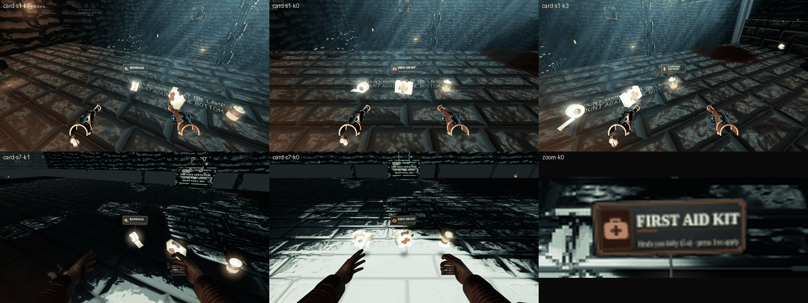

# THE LANTERN: item cards

Owner: "if the user starts looking at an object that is down, there must be like some sort of name. It should be like a text that says
bandage in a unique card. It should not be floating in the space. It should be with the text should be in the background."

When the player looks at a collectible lying in the world, a **name card** stands over it: a worn slate tag on a thin iron wire stake
planted on the item, with the name in large old-paper letters ("BANDAGE"), a small icon in the kind's own colour and one hint line
("Heals a little (1.5 s) · press 2 to apply"). The text is always printed on the plate, never bare glyphs in the air, and the card is
an object in the world (depth-tested, fogged, turning only about its vertical axis), not a HUD overlay.

## 1. Pieces

| File | Role |
| --- | --- |
| `src/sim/itemGaze.js` | pure: which item the eye is on (range, cone, distance weight, hysteresis, dwell, grace, occlusion, busy). No allocation per frame |
| `src/data/itemCards.js` | the card text per kind: name, hint, the use line per platform, accent colour, icon id; `cardFor` (with the generic fallback) and `cardHint` |
| `src/render/itemCardView.js` | ONE mesh (the card + its stake in one geometry: one draw call), one 512 x 256 canvas texture redrawn on a content change only |
| `src/itemCardGlue.js` | the per-frame glue (the `puzzleFocusGlue.js` pattern): candidates from the pickups and the fuel cans, the eye from the rig + camera, the busy test, the setting |
| `src/game.js` | `_setupItemCards()` next to `_setupPuzzleFocus()`, `itemCards.update(dt)` in `_updateViews` after the puzzle focus, `AT3D.debug.itemCard()` |

## 2. What counts as a collectible

* the run's supplies, `game.pickups.items` (sim/pickups3d.js) not yet taken: kinds 0 FIRST_AID, 1 BANDAGE, 2 ADRENALINE, 3 BATTERY,
  4 KNOCKER, and any kind added to the enum later (5 GRENADE and 6 SIDEARM have cards already);
* the jetpack's fuel cans, `game.jet.cans` (sim/jetpack3d.js) not yet taken, card key `FUEL_CARD` (16, not a bag kind).

The dropped props (`render/droppedProps.js`) are dressing (a spent or fumbled item that melts away) and are not collectible: no card.

## 3. The gaze (sim/itemGaze.js)

| Rule | Value |
| --- | --- |
| range | 6 m (closer than 0.25 m does not count) |
| cone | 11 degrees half-angle + the prop's own angular radius (atan(0.16 m / d)), so a close item is easy to hit |
| score | angle / cone + 0.35 x distance / range (lower wins: of two items on one line the nearer wins) |
| hysteresis | the item shown keeps a 1.35x cone and a 0.3 score bonus: two neighbours never flicker |
| dwell | a new item must stay the best for 0.2 s before its card shows (or replaces the shown one) |
| grace | the card stays 0.3 s after the look leaves it |
| collected | an item that leaves the list hides the same frame (no grace) |
| occlusion | `level.raycast` from the eye to the prop's top; a hit more than 0.3 m short of it hides it (a hit inside that margin is its own ledge). Asked for the best candidate, and once for the second if the best is hidden |
| busy | nothing while dead, not `playing` (menus, pause), in the victory, the opening film, the death scene, or while applying a bag item |

The eye is the rig plus the camera's local position turned by the rig's yaw; the forward is the camera's local quaternion turned by the
rig's yaw (the headset pose in XR). The glue only reads the camera: it never turns the view, never rolls it, never moves the rig.

## 4. The card (render/itemCardView.js)

* **Plate**: a chamfered dark slate (#30353a to #1a1d20), speckled grain and a few scratches (a seeded LCG per content key: no
  `Math.random`), scuffed corners, a pale worn bevel broken in places, a thin inset frame in the kind's accent, four rivets.
* **Icon**: in an accent-tinted block on the left: case + cross (first aid), roll + tail (bandage), syringe, cell + bolt (battery),
  cog rattle (knocker), pineapple grenade, revolver, fuel can, a crate for an unknown kind.
* **Name**: Georgia bold, upper case, 56 px on the canvas on one line, or two lines at 48 px for a long name ("LANTERN / BATTERY").
* **Hint**: one line, 31 px (shrinks to 24 px, then condenses, to fit): what it does, a middle dot, how to use it on this platform.
* **Stake**: a 7 mm iron wire from the prop's top to a clip at the card's lower edge (same geometry, sampled from a strip below the card
  on the same canvas).
* **Size**: width = 0.26 x distance within [0.26, 0.9] m, so the name keeps >= 28 px on a Quest 3 (25 px per degree) at 0.8 to 2 m
  (51 / 41 / 41 / 41 px at 0.8 / 1.2 / 1.5 / 2 m; a two-line name at 48 px: 35 px). The lower edge stands 0.24 m above the item centre; the card leans back 0.12 rad.
* **Orientation**: a yaw toward the eye only, a small settled roll per item (deterministic from its id, under 2 degrees), a slight
  breathing sway that stops with Reduced effects.
* **Material**: `MeshBasicMaterial` (unlit: no lit sampler is added, the Quest's 16-sampler limit is untouched), `toneMapped: false` so the
  plate keeps the same muted brightness in the darkest sections (a printed card, not a glowing sign), `fog: true` (it fades with the
  world far off), `depthTest: true` (never through a wall), no depth write. Fades in / out in 0.15 s; a new item fades the old card out
  first and swaps at zero.
* **Cost**: +1 draw call while a card shows (0 when hidden), 4 triangles, one 512 x 256 texture. The canvas is redrawn only when the
  content key changes (kind, platform, bag full); positions are rewritten only when the width changes by more than 2 mm.
* `dispose()` releases the texture, the material and the geometry.

## 5. The text

| Kind | Name | Hint | VR | Desktop | Touch |
| --- | --- | --- | --- | --- | --- |
| 0 | First aid kit | Heals you fully (5 s) | hip + grip to apply | press 1 to apply | tap BAG to apply |
| 1 | Bandage | Heals a little (1.5 s) | hip + grip to apply | press 2 to apply | tap BAG to apply |
| 2 | Adrenaline shot | Twice as fast for 10 s | hip + grip to apply | press 3 to apply | tap BAG to apply |
| 3 | Lantern battery | Refills half the lantern | hip + grip to apply | press 4 to apply | tap BAG to apply |
| 4 | Knocker | Throw it: the Mason answers knocks | grip at hip, pull up | hold G, release | BAG, then KNOCK |
| 5 | Grenade | Throw it: scares the Mason off | from the bag | from the bag | from the bag |
| 6 | Service revolver | Fire it: a hit scares the Mason off | from the bag | from the bag | from the bag |
| fuel | Jetpack fuel | Half a tank for the jetpack | both triggers in a fall | J in a fall | JUMP in a fall |

The numbers are CONFIG.bag's (heal 1 / 0.2, apply 5 s / 1.5 s, adrenaline 2x for 10 s, battery 0.5) and JET.canFuel; the inputs are the
tutorial's (`ui/tutorial.js`) and the desktop bag keys (`input/desktopInput.js` BAG_SLOT_KEYS). Names come from `ITEM_NAMES` where it has
the kind. Kinds 5 and 6 are placeholders for the weapons work to refine. A full bag says "Your bag has no room for this"; a full tank
"Your jetpack tank is already full". An unknown kind gets a generic card named from `ITEM_NAMES` ("Supplies" without a name), and the
test fails for any ITEM enum kind without its own entry.

## 6. Switches

* Setting `itemCards` (default on; `SETTINGS_DEFAULTS`, end of the WP-UX block; `sanitizeUxSettings`: on unless `false`), row
  "Item cards" on the Rope page (in VR the page now holds eight rows at 64 px: 190 + 8 x 64 = 702 px, inside the panel).
* `?itemcards=off` (or `0`, `false`, `no`) turns them off whatever the setting says.
* `AT3D.debug.itemCard()`: `{ enabled, urlOff, candidates, target, pending, name, hint, view: { visible, alpha, width, redraws, key }, stats }`.

## 7. Tests and captures

* `tools/abyssal-tether-3d/tests/ux/item-card.mjs` (in `run-tests.mjs`): the gaze rules, the cards table, the view (one mesh, the
  material, one redraw per content, yaw only, clamps and the 28 px floor, fades, the two-line name, no allocation, dispose), the glue
  against a stand-in game (pickups + fuel cans, platform hints, busy states, the camera never written, no allocation) and the setting.
* The captures (`img/item-cards-*.png`) come from the real game in software GL: the player 1.5 m from a bandage, a first aid kit and
  a battery spawned on the stone floor (`AT3D.debug.bag.spawn` / `pickups.spawnAt`), frozen, the lantern on, in S1 and a deep section.

The contact sheet (S1 x3, S7 x2, and a zoom on the first aid card) was captured BEFORE the last sizing pass (k 0.22 to 0.26, wmin 0.24 to
0.26, wmax 0.8 to 0.9, hint 27 to 31 px): in the game today the card is about 18 % wider and the hint line larger than shown. The S7
shots are lit by the lantern close up; a capture in a truly dark section is still to do.
