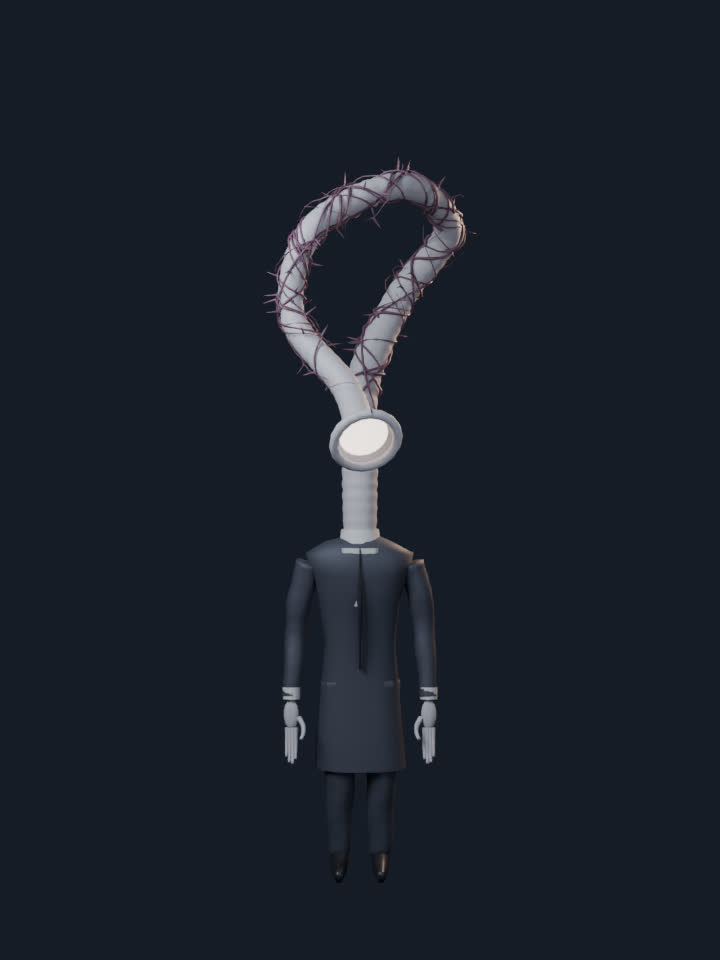
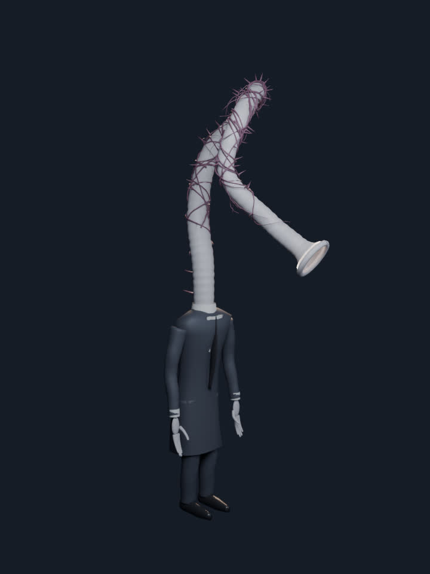
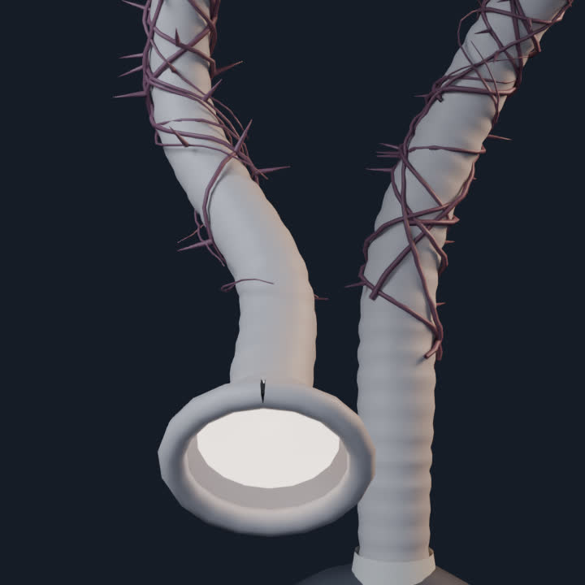
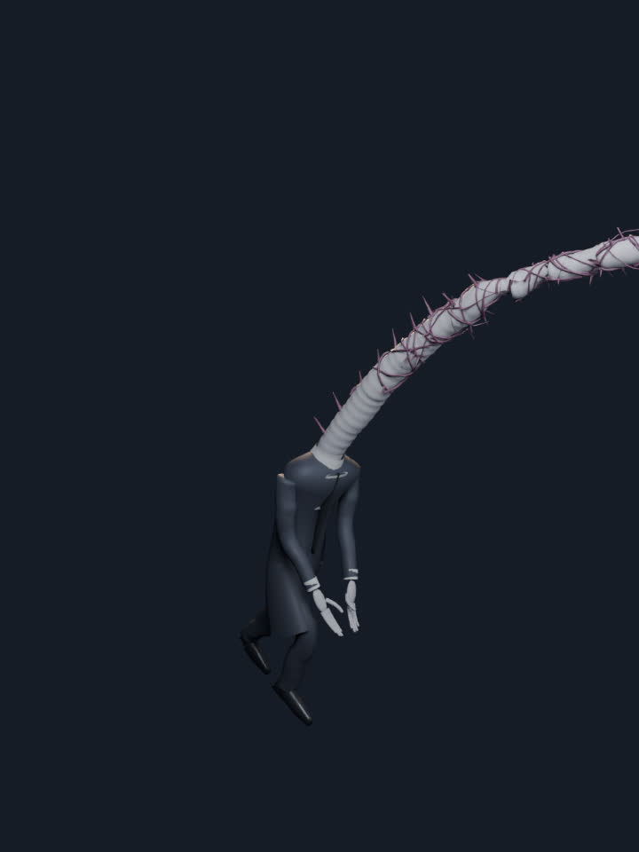
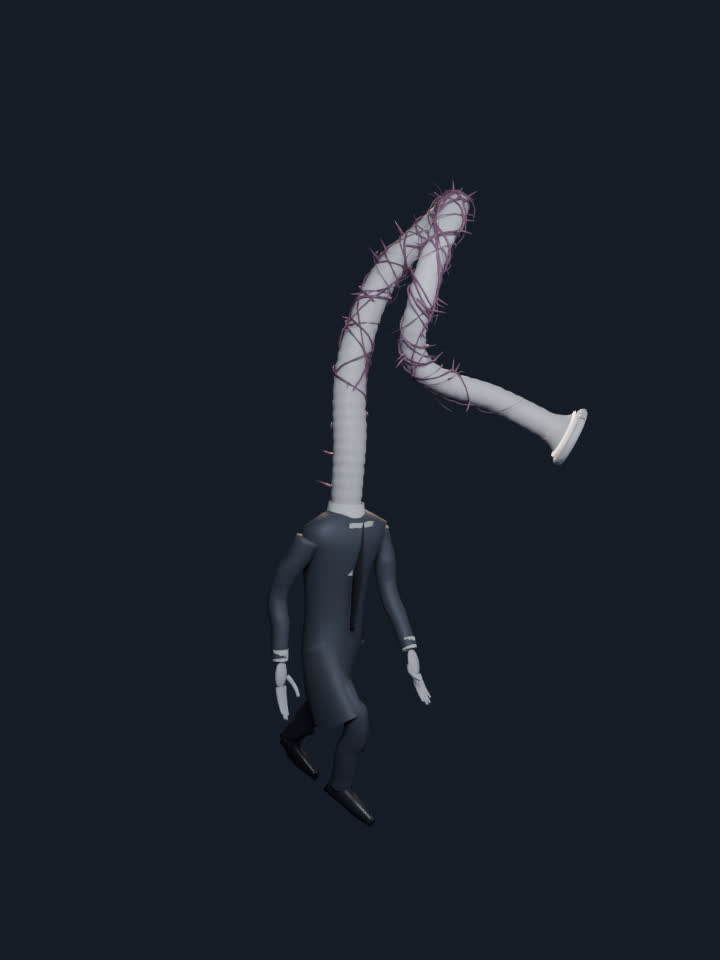

# THE USHER: the headless man whose throat goes on

> "This guy must be a villain. Make him in Blender." (a screen recording of a Blender sculpt: rows of grey, headless men in suits standing in a drained
> pool, a long ribbed tube coiling out of a collar, veins and spines round it, a bright ring where a face should be; "Nightmares can be beautiful too.")

This is NOT a copy of that artwork. It is an original character built from code for the game's second chapter (see CHAPTER_II_PLAN.md): the owner's
sculpt gave the idea (a suit, no head, a throat that goes on, a ring of light), not the shapes.

| front | three-quarter | the ring |
| --- | --- | --- |
|  |  |  |

| the lunge (peak) | the walk |
| --- | --- |
|  |  |

Clay renders from `build_usher.py --render` (Cycles, 14 samples). Not the game's look: in the game he is cel-shaded and inked like everything else.

## What he is

A 1.95 m man in a long dark coat, white collar and a black tie, long pale hands, long black shoes, stooped. No head. From the collar a ribbed throat
(a tracheal tube, 3.75 m, thicker at the root) rises, coils over his shoulders in an S and a hook, and ends in a flared ring held at the height of a
face. Inside the ring a cold pale membrane glows: it is the only light he has. Thin veins and thorns wind round the throat. He walks without hurry; the
throat sways a beat behind him. The Lunge draws the throat back, then whips it straight and forward over his body while the ring opens.

Story slot (proposal, CHAPTER_II_PLAN.md): the thing that ushers the kept down into Lamphold, and the face of the hook that ends the chapter.

## The asset

`public/abyssal-tether-3d/assets/models/usher.glb` (0.34 MB, EXT_meshopt_compression, KHR_mesh_quantization), built by
`tools/abyssal-tether-3d/build_usher.py` (deterministic, seed 1313, no textures: six flat materials so the game paints it with its own shaders).

* 28.7 k triangles, 14.9 k vertices, 6 skinned primitives (suit, shirt, skin, vein, shoe, glow) sharing one skeleton of 34 bones.
* Skeleton (the contract for a future `render/usherView.js`): `Root > Pelvis > Spine1 > Spine2 > Spine3 > { Clavicle_X > UpperArm_X > Forearm_X > Hand_X,
  Neck01 > ... > Neck14 > Maw }`, `Pelvis > Thigh_X > Shin_X > Foot_X`. Frame: glTF +Y up, he faces +Z.
* Clips (24 fps): `Idle` (2 s loop), `Walk` (1.33 s loop), `Listen` (2.5 s loop: the ring turns toward a sound), `Lunge` (1.5 s, once: the throat
  straightens and leans over him, the `Maw` bone scales up 1.7x to open the ring).
* Weights: the body by capsule distance among the allowed bones of each part (a sleeve cannot pull a trouser); the throat by arc position, blending
  into `Spine3` over the first 4 % and the ring (`rim`, `membrane`) owned by `Maw`.
* Not in the game yet: no view, no sim, no sound. `usher.glb` is in the lazy precache list (like the Dresser and the Holdfast), so it costs nobody a
  download until a chapter uses it.

## Rebuild

```
flock /tmp/at3d-blender.lock $PY tools/abyssal-tether-3d/build_usher.py --out <dir> [--render --renders <dir>] [--skip-rest] [--blend <file>]
cp <dir>/usher.glb public/abyssal-tether-3d/assets/models/
GLTF_TOOLS=$TOOLS node tools/abyssal-tether-3d/compress_glbs.mjs --only usher
```

Test: `tests/render/test-glb-usher.mjs` (compression, one skin, 6 materials, the bone contract and chain, the clips and their lengths, the throat
channels and the ring scale, the posed bounds, normalised weights, the lip of the ring owned by the end of the throat).

## Honest limits

* A first pass from code: clay shapes, no sculpted anatomy (the owner's reference is a hand sculpt), cloth folds are a few sine waves, hands are
  capsules and tubes. It reads as the character; it is not final art.
* No face-side detail inside the ring beyond a glowing dish; no textures, no normal maps; the cel look and the ink hull come from the game's shaders.
* The throat's bone wave is rotation only (it cannot stretch), so the lunge reaches 3.7 m by straightening, not by growing.
* Not seen in the game, on a headset, or against the Quest budget (28.7 k triangles in 6 draw calls; one ink hull would add one).
